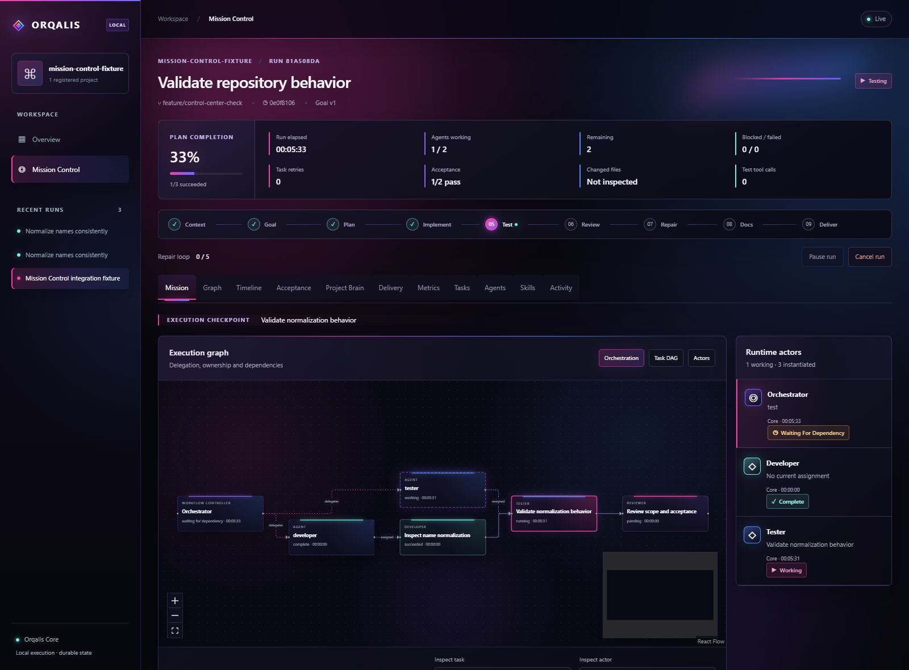

<p align="center">
  
</p>

<h1 align="center">Orqalis</h1>

<p align="center">
  A local-first engineering orchestrator for durable project memory, evidence-based review,<br>
  and controlled Git delivery across AI providers and assistants.
</p>

<p align="center">
  <a href="docs/RELEASE_NOTES.md"></a>
  <a href="#architecture"></a>
  
  
  <a href="LICENSE"></a>
</p>

<p align="center">
  <a href="#overview">Overview</a> &middot;
  <a href="#quick-start">Quick start</a> &middot;
  <a href="#control-center">Control Center</a> &middot;
  <a href="#architecture">Architecture</a> &middot;
  <a href="#development">Development</a> &middot;
  <a href="#documentation">Documentation</a>
</p>

---

## Overview

Orqalis keeps engineering work connected to the repository it belongs to. Project
knowledge, task progress, review evidence, and delivery history live in a structured
`.orqalis/` directory, so another assistant can pick up the work without the previous
conversation. Standard operation requires no external database.

| Capability | What it gives you |
| --- | --- |
| **Durable project memory** | Curated decisions, conventions, and pitfalls with provenance, reviewed supersession, bounded discovery, and stale-record detection. |
| **Repository-aware context** | Python and JS/TS/TSX syntax graphs, exact symbol reads, and local lexical retrieval. |
| **Recoverable tasks** | Task Capsules that preserve requests, execution snapshots, events, evidence, and outcomes. |
| **Evidence-based review** | Acceptance checks, bounded repair loops, and explicit execution and delivery policies. |
| **Provider-neutral workflows** | Shared application services through the CLI, Python SDK, MCP, API, and browser UI. |
| **Local Control Center** | Run and agent traces, critical paths, provider metrics, verification, and delivery. |

## Quick start

**Requirements:** Node.js **22+**, Python **3.12+** with `venv` and `pip`, and Git.
The npm launcher creates a hash-verified, isolated Python runtime for your user on first
use. Docker is optional and only needed for container-isolated command execution.

### 1. Install and initialize

Install the released local-first version from npm:

```sh
npm install -g orqalis@2.1.0
orqalis --version

cd /path/to/your/repository
orqalis init
orqalis doctor
orqalis status
```

For a reviewed local build, follow the [packaging guide](docs/PUBLISHING.md#prepare-the-artifact).
Historical 1.0.x releases use a different, database-backed architecture; their setup
instructions do not apply to this checkout.

On Windows, use `orqalis.cmd` if PowerShell blocks the generated `.ps1` shim.
Use `orqalis init --repo PATH` to select an explicit repository root.

### 2. Configure a provider when needed

Initialization, local memory, and repository inspection do not need provider credentials.
For provider-backed workflows, set the model and credentials in your shell:

<details>
<summary>Bash / Zsh</summary>

```sh
export ORQALIS_OPENAI_MODEL="your-model"
export ORQALIS_OPENAI_API_KEY="your-api-key"
# Or use ORQALIS_ANTHROPIC_MODEL and ORQALIS_ANTHROPIC_API_KEY.
```

</details>

<details>
<summary>PowerShell</summary>

```powershell
$env:ORQALIS_OPENAI_MODEL = "your-model"
$env:ORQALIS_OPENAI_API_KEY = "your-api-key"
# Or use ORQALIS_ANTHROPIC_MODEL and ORQALIS_ANTHROPIC_API_KEY.
```

</details>

Keep credentials in environment variables, an OS keychain, or assistant/provider
configuration. Never write them to `.orqalis/`.

### 3. Prepare and inspect a run

```sh
orqalis run "Add feature X" --repo .
orqalis runs
orqalis tasks
orqalis ui --open
```

`run` persists the request and context before provider execution. Execution and delivery
use explicit policy documents. Replace `RUN_ID` with the run UUID listed by
`orqalis runs`, and supply policies appropriate to your repository:

```sh
orqalis execute RUN_ID --policy execution-policy.json --provider openai
orqalis finalize RUN_ID --policy delivery-policy.json
```

Use `orqalis run --help` for supervised gates, explicit goal contracts, branches, and
combined prepare/execute options. See [security and governance](docs/06-security-git-and-governance.md)
for execution and delivery boundaries.

## Control Center

Inspect the project from a local browser: follow run progress, explore task and actor
graphs, inspect memory, and review evidence and delivery state.



<p align="center">
  <a href="docs/assets/orchestration-graph.jpg">Task graph</a> &middot;
  <a href="docs/assets/project-memory.jpg">Project memory</a> &middot;
  <a href="docs/assets/verification-repair.jpg">Verification and repair</a> &middot;
  <a href="docs/assets/repository-delivery.jpg">Git delivery</a>
</p>

```sh
orqalis ui --open
# Or start the host without opening a browser:
orqalis serve
```

The host belongs to the terminal: **Ctrl+C** stops it; closing the browser tab does not.
No service or autostart entry is installed. The UI loads persisted snapshots and event
history through the API, then receives live events over WebSocket.

See the [dashboard guide](docs/10-local-control-center.md) for the complete interface and screenshot gallery.

## Architecture

Every interface shares the same application services and repository-local store.
Repository structure, curated knowledge, and task history have separate responsibilities:

| Layer | Responsibility |
| --- | --- |
| **Repository graph** | Observable files, symbols, and relationships, with extracted and inferred facts distinguished. |
| **Curated memory** | Decisions, conventions, terminology, constraints, and their provenance. |
| **Task Capsules** | What was requested, how execution progressed, and the evidence behind the outcome. |

Expand the implementation details below, or read the
[system architecture](docs/01-system-architecture.md) and
[source-of-truth rules](docs/SOURCE_OF_TRUTH.md).

<details>
<summary><strong>The project-local store</strong></summary>

Initialization creates only useful files and directories. A populated store resembles:

```text
.orqalis/
|-- manifest.yaml
|-- config.yaml
|-- .gitignore
|-- project/
|   |-- identity.yaml
|   |-- summary.md
|   |-- tech-stack.yaml
|   |-- commands.yaml
|   |-- repository.yaml
|   `-- current-state.md
|-- memory/
|   |-- product.md
|   |-- architecture.md
|   |-- technology.md
|   |-- conventions.md
|   |-- domain.md
|   |-- workflows.md
|   |-- testing.md
|   |-- pitfalls.md
|   |-- records/
|   |-- staging/
|   |-- history/
|   |-- lifecycle.json
|   `-- graph/
|-- tasks/
|   |-- index.json
|   `-- ORQ-YYYYMMDD-NNNN/
|-- index/
|-- runtime/
`-- cache/
```

The layout is schema-versioned. Files named `.yaml` currently contain formatted JSON,
which is valid YAML 1.2. PyYAML is used separately for strict portable skill frontmatter. Mutable structured
documents are written to temporary files, flushed, validated, and atomically replaced.
Project and task locks live under `.orqalis/runtime/locks/`.

### Canonical and derived data

Canonical data is the source of project continuity:

- `manifest.yaml`, `config.yaml`, and `project/` identity and durable project documents;
- curated memory records, decisions, provenance, reviewed proposals, and `memory/lifecycle.json`;
- Task Capsules, including requests, goals, acceptance, execution snapshots, events,
  evidence, reviews, delivery state, and final summaries.

Derived data is disposable and reconstructable:

- repository graph files under `memory/graph/`;
- lexical/search indexes under `index/`;
- parser and ranking caches under `cache/`;
- graph HTML and other generated views.

Deleting `cache/` or `index/` does not delete task history or curated memory. Run
`orqalis rebuild-index --repo PATH` to rebuild graph and lexical index data from the
repository and canonical project records. Idempotent `orqalis init --repo PATH` also
restores missing bootstrap-derived data.

### Git tracking policy

The generated `.orqalis/.gitignore` ignores machine-local runtime state, locks, caches,
derived indexes, generated graph HTML, and raw event streams. Project documents, curated
memory, and durable Task Capsule summaries remain eligible for Git tracking. Configure the
policy in `.orqalis/config.yaml`:

```yaml
{
  "git": {
    "track_project_memory": true,
    "track_task_history": true,
    "track_execution_events": false,
    "track_generated_graph_html": false
  }
}
```

All data stays physically under the repository even when ignored by Git.

</details>

<details>
<summary><strong>Project root isolation</strong></summary>

Every operation binds to one resolved root. Resolution order is:

1. an explicit CLI/API/MCP root (`--repo` or `--root`);
2. `ORQALIS_PROJECT_ROOT`;
3. the current Git root;
4. the current directory when it is not a Git worktree.

Explicit roots are authoritative and fail closed when invalid. Stored paths are
repository-relative where possible, and storage writes are contained under that root.
Run one MCP process per repository, for example:

```sh
orqalis mcp --root /path/to/repo-a --policy /absolute/path/to/mcp-policy.json
```

Another assistant can simultaneously use repo B with its own `--root`; neither process can
retrieve or write the other's `.orqalis/` state.

</details>

<details>
<summary><strong>Repository graph and local retrieval</strong></summary>

`orqalis init` performs a deterministic repository scan. Python source uses AST extraction
for files, modules, classes, functions, methods, tests, imports, calls, and inheritance.
JavaScript, TypeScript, and TSX use pinned Tree-sitter grammars. Exact symbol reads verify
source hashes and UTF-8 byte spans. Dynamic relationships remain source occurrences;
syntax extraction does not claim type-checker or language-server completeness. File nodes
report incomplete extraction and its limits. Other source/configuration/document formats
receive typed file nodes.
Edges distinguish `EXTRACTED` facts from `INFERRED` relationships and carry confidence and
evidence.

The graph manifest records branch, HEAD, content hashes, parser version, schema version,
and last indexed time. Refresh compares Git state and file hashes, handles dirty and
untracked relevant files, reparses only changed content, and removes deleted or renamed
paths. Parser results are cached by SHA-256 under `.orqalis/cache/parser/`.

The derived project index writes `files.jsonl`, `symbols.jsonl`, `relations.jsonl`,
`terms.json`, and `task-index.json`. Retrieval combines lexical terms, symbol and path
matches, graph relationships, memory, Git state, and related Task Capsule summaries. No
embedding provider or vector database is required.

</details>

<details>
<summary><strong>Curated project memory</strong></summary>

Repository graph facts, curated knowledge, and task history are separate:

- the graph describes observable repository structure;
- curated memory records why the system is built this way, conventions, terminology,
  constraints, pitfalls, and decisions;
- Task Capsules describe what Orqalis was asked to do and what happened.

Durable memory records carry source paths and hashes, verified commit, originating task,
confidence, and verification time. A record becomes `STALE` when its provenance no longer
matches the repository. Durable updates support `auto`, `review`, and `manual` policy;
reviewed proposals live under `memory/staging/` before promotion. Candidate memory is
scanned for credentials and private diagnostic material before persistence. Reviewed
supersession preserves historical records while default retrieval selects the active
successor. Discovery previews and explicit body/reference reads keep context bounded.

Current memory commands are:

```sh
orqalis memory status --repo .
orqalis memory refresh --repo .
orqalis memory search "retry policy" --repo .
orqalis memory graph --repo .
orqalis memory discover "retry policy" --repo .
orqalis memory check --repo .
orqalis memory proposals --repo .
orqalis context "change offline retry" --repo .
orqalis rebuild-index --repo .
```

`memory refresh` explicitly revalidates approved stale records against the current Git
commit; use repeated `--record MEM-...` options to limit revalidation to selected records.

</details>

<details>
<summary><strong>Task Capsules and recovery</strong></summary>

Each request immediately receives `.orqalis/tasks/ORQ-YYYYMMDD-NNNN/`. Its
`execution/state.yaml` is the authoritative current snapshot and
`execution/events.jsonl` is the append-only operational history. Stage projections are
human-readable, recoverable views of the snapshot; they are not competing state.

A mature capsule can contain:

```text
request.md                 task.yaml
context/                   goal/                 plan/
execution/state.yaml       execution/events.jsonl
execution/phases/          execution/agents/     execution/subtasks/
review/                    evidence/             artifacts/
changes/                   delivery/             final/
```

Only reached stages are created. Terminal final files are emitted for completed, failed,
or cancelled runs; blocked, paused, and human-review runs remain resumable. A new process
loads the snapshot, event cursor, DAG, review state, and extensions from files. It does not
need the previous assistant conversation or a database recovery process.

Useful inspection and control commands include:

```sh
orqalis runs --json
orqalis runs show RUN_ID --json
orqalis tasks --json
orqalis task show ORQ-YYYYMMDD-NNNN --json
orqalis runs pause RUN_ID
orqalis runs resume RUN_ID
orqalis runs cancel RUN_ID
orqalis runs recover RUN_ID EXECUTION_ID --reason "..." --acknowledge-uncertainty
orqalis doctor --repo .
```

</details>

## Assistant integration

Connect an MCP client to an initialized repository using an explicit root and policy:

```sh
orqalis mcp --root /path/to/repository --policy /absolute/path/to/mcp-policy.json
```

Run one MCP process per repository. CLI, Python SDK, MCP, FastAPI, WebSocket, and the
React Control Center share the same application services and filesystem-backed unit of
work; the frontend never reads `.orqalis/` directly.

See [MCP setup](docs/MCP.md) for policies, available tools, and assistant-host examples.

## Operations

Back up durable project memory and Task Capsules with your repository. Execution uses
explicit permissions, while derived indexes and caches can be rebuilt.

<details>
<summary><strong>Security and execution isolation</strong></summary>

Orqalis never stores hidden model chain-of-thought. Persisted events are structured
operational records. Requests, context, memory, event payloads, and Task Capsule state are
checked for credential patterns and private diagnostic markers.

Execution permissions are explicit: repository-relative write paths, exact command argv,
timeouts, tool limits, and delivery policy. `trusted_local` runs approved commands on the
host. `docker` provides an optional stronger command sandbox with no network, a read-only
root, dropped capabilities, and resource limits; its image must already exist locally.
Application-owned containers have durable ownership receipts. Recovery verifies daemon,
labels, and exact container identity, and blocks uncertain cleanup before further work.
Docker is not required for initialization, memory, graph, task persistence, MCP, API, or UI.

</details>

<details>
<summary><strong>Backup, migration, and upgrades</strong></summary>

Back up or commit the durable portions of `.orqalis/` with the repository. Never rely on
`cache/`, `index/`, or `runtime/` as the only copy of important information. Filesystem
schema migrations validate the old manifest, preserve affected source files under
`.orqalis/backups/`, transform and validate the new layout, then atomically update the
manifest.

PostgreSQL, SQLAlchemy, Alembic, psycopg, and pgvector are not part of the current runtime
or package. The former SQL adapters and `orqalis migrate` command have been removed. A
PostgreSQL-to-filesystem exporter is not implemented; preserve legacy data separately and
use the matching historical Orqalis release if a bespoke export is required.

</details>

See [local operation and recovery](docs/OPERATIONS.md) for troubleshooting.

## Development

Source development also requires [uv](https://docs.astral.sh/uv/). From the repository root:

```sh
uv sync --group dev
npm ci --prefix web
npm ci --prefix packages/npm
uv run orqalis --help
```

Follow [the development guide](docs/DEVELOPMENT.md) for quality checks, isolated test
fixtures, frontend development, and screenshot capture. Read the
[publishing guide](docs/PUBLISHING.md) for artifact preparation and release gates.

## Documentation

| Guide | Contents |
| --- | --- |
| [Interfaces and integrations](docs/05-interfaces-and-integrations.md) | CLI, SDK, MCP, portable skills, graphs, memory, and traces. |
| [Open-source review](docs/OPEN_SOURCE_REVIEW.md) | Compared projects, adoption decisions, evidence, and limits. |
| [Enhancement audit](https://github.com/Satyajit-Senapati/Orqalis/blob/main/docs/quality/ENHANCEMENT_STATUS.md) | Accepted capabilities, validation evidence, and convergence status. |
| [Operations](docs/OPERATIONS.md) | Initialization, backup, recovery, and troubleshooting. |
| [MCP integration](docs/MCP.md) | Assistant setup, policies, tools, and cross-assistant continuity. |
| [Dashboard](docs/10-local-control-center.md) | Navigation, operator controls, and product screenshots. |
| [Product design and roadmap](docs/00-product-design.md) | Product scope, principles, journeys, and dated roadmap. |
| [System architecture](docs/01-system-architecture.md) | Runtime components and application boundaries. |
| [Project memory](docs/03-project-memory.md) | Repository graph, curated knowledge, and retrieval. |
| [Workflow and acceptance](docs/04-workflow-and-acceptance.md) | Goals, planning, evidence, review, and repair. |
| [Development](docs/DEVELOPMENT.md) | Local setup, validation, and contribution checklist. |
| [Benchmark methods](https://github.com/Satyajit-Senapati/Orqalis/blob/main/benchmarks/README.md) | Quality, execution, memory, UI, and constrained workloads. |
| [Publishing](docs/PUBLISHING.md) | Packaging, release gates, and updates. |
| [Release notes](docs/RELEASE_NOTES.md) | Unreleased enhancements and historical releases. |

Architecture and ownership rules are recorded in [SOURCE_OF_TRUTH.md](docs/SOURCE_OF_TRUTH.md),
[SIGNOFF.md](SIGNOFF.md), and the [architecture decisions](docs/adr/).
Dated verification records describe the architecture tested at that date.

## License

Orqalis is licensed under the [MIT License](LICENSE).
